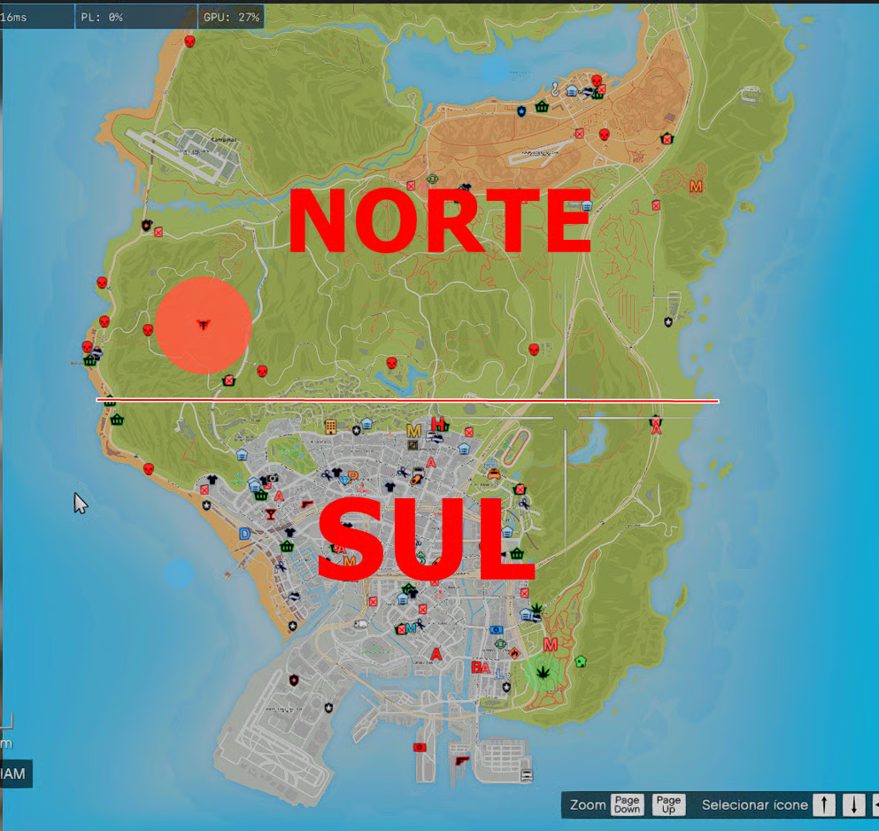

# zonas norte sul

Áreas que definem **Zona Sul** e **Zona Norte** na Grajaú.

## Para que serve

| Regra                           | Sul            | Norte           |
| ------------------------------- | -------------- | --------------- |
| Assalto de rua                  | **Proibido**   | **23:00–06:00** |
| Armamento em ação de rua / fuga | Só **pistola** | **Qualquer**    |

Detalhes:

* [Assalto de rua](file:///0125121/04-ilegal/assalto-de-rua.md)
* [Fugas e perseguições](file:///0125121/04-ilegal/fugas-e-perseguicoes.md)

## Mapa

<figure><figcaption></figcaption></figure>
